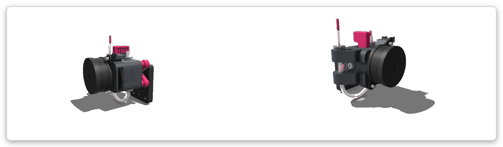
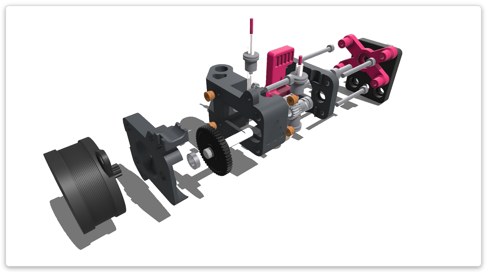

# 🥣 Pestle Rotational Bowden

*The flexible Bowden system designed to fit almost anywhere, while providing rotational movement to support even shorter Bowden assemblies.*

  

**[Print Settings](#%EF%B8%8F-print-settings)** &nbsp;•&nbsp; **[Printed Parts & CAD](#-printed-parts--cad-files)** &nbsp;•&nbsp; **[Bill of Materials](#-bill-of-materials-bom)** &nbsp;•&nbsp; **[Assembly Guide](#%EF%B8%8F-assembly-guide)** &nbsp;•&nbsp; **[Retraction Settings](#-retraction-settings)** &nbsp;•&nbsp; **[Discord](https://discord.gg/aE49DW2xXe)**

 

---

## 📖 Preface

This is the Pestle Rotational Bowden.

The goal of this project is to provide an ultra-lightweight but powerful extruder which rides the X gantry (or anywhere else you wish) while also being able to rotate, allowing the shortest Bowden tube possible. The rotation removes the need for additional bend radii to get to the toolhead by providing a more direct route.

Initial testing of this unit showed it was able to achieve a Bowden length of approximately `< 228.6mm`, when the stock tube was near `508mm` long. That is an improvement of 50%. On top of the PTFE length savings, the more direct filament route results in much lower PA values than traditional Bowden setups, as well as retraction settings which are more in line with Direct Drive. All of these benefits combined create a system that takes the best from each world without sacrificing overall performance.

The concept for this extruder was inspired by the now-defunct Voron Jetpack. We would like to extend a special thanks to the Voron team for their inspiration on this product. Please take a moment if you are not familiar with the Voron project to educate yourself on the hard work they commit to the makerspace: [https://vorondesign.com/](https://vorondesign.com/)

---

  

---

## ⚙️ Print Settings

| Setting | Value |
| :--- | :--- |
| **Materials** | ABS/ASA *(Note: Parts account for shrinkage of ASA & ABS)* |
| **Layer Height** | 0.20 mm |
| **Extrusion Width** | Forced 0.4 mm |
| **Infill Percentage** | 40%+ |
| **Infill Type** | Grid, Honeycomb, Triangle, or Cubic |
| **Top/Bottom Wall Count** | 5 |
| **Perimeter Count** | 4 |
| **Supports** | None |

---

## 🖨️ Printed Parts & CAD Files

All STL meshes and the full `Rev 1.2` assembly STEP live in [`Releases/1.2/`](Releases/1.2/). Per [`Releases/1.2/STLs/README.md`](Releases/1.2/STLs/README.md), standard files print in the **Primary** color and `[a]_` prefixed files print in the **Accent** color (`Pestle_Rev-1.2.step` envelope: `81.59 × 115.87 × 127.63 mm`).

| File Name | Color / Role | Volume (`cm³`) | Notes |
| :--- | :---: | :---: | :--- |
| [`pestle_main_body.stl`](Releases/1.2/STLs/pestle_main_body.stl) | Primary | `15.77` | Main extruder body, lever pivot pocket, and tension spring recess |
| [`pestle_top_plate.stl`](Releases/1.2/STLs/pestle_top_plate.stl) | Primary | `4.60` | Top plate with MR85ZZ bearing bore and dual `PC4-M6` seats |
| [`pestle_motor_plate.stl`](Releases/1.2/STLs/pestle_motor_plate.stl) | Primary | `5.66` | Stepper / transmission plate with heat-set and MR85ZZ bearing seats |
| [`[a]_pestle_lever.stl`](Releases/1.2/STLs/%5Ba%5D_pestle_lever.stl) | Accent | `4.38` | Tensioner lever arm housing secondary drive gear & needle bearings |
| [`[a]_pestle_rotation_brace.stl`](Releases/1.2/STLs/%5Ba%5D_pestle_rotation_brace.stl) | Accent | `3.86` | Rotational cross brace bridging extruder assembly to swivel mount |
| [`pestle_2020_extrusion_mount.stl`](Releases/1.2/STLs/pestle_2020_extrusion_mount.stl) | Primary | `15.22` | Optional 20x20 mm aluminum extrusion frame mount |
| [`pestle_3DFused_gantry_mount.stl`](Releases/1.2/STLs/pestle_3DFused_gantry_mount.stl) | Primary | `11.76` | Optional 3DFused gantry mount |
| [`Pestle_Rev-1.2.step`](Releases/1.2/CAD/Pestle_Rev-1.2.step) | CAD Assembly | — | Complete `Rev 1.2` assembly reference STEP (`61.25 cm³` total printed volume across all 7 STLs) |

---

## 📋 Bill of Materials (BOM)

> [!NOTE]
> **Affiliate Links**
> This document contains affiliate links. Sourcing your parts through these links helps support the continued development of Alchemical-3D projects at no additional cost to you! If you wish to configure a Pestle kit through a vendor (KB-3D) instead of sourcing individual parts, use this link [here](https://kb-3d.com/store/extruders-hotends/731-pestle-rotational-bowden-extruder-kit-beta-12-configurable-1670209967306.html?affp=6182).
>
> *Note: This list is the bare minimum. It is wise to have spare screws, heat sets, etc.*

| QTY | Material | Notes |
| :---: | :--- | :--- |
| **6** | [M3x5x4 Heatsets](https://kb-3d.com/store/inserts-fasteners-adhesives/278-brass-heat-set-threaded-insert-for-plastic-m3x5x4mm.html?affp=6182) | Angled exterior texture, not straight *(3 in Main Body, 1 in Lever, 2 in Transmission Plate)* |
| **1** | [Thrust Bearing](https://kb-3d.com/store/magnets-bearings/696-5mm-x-12mm-x-4mm-thrust-bearing-f5-12m-1645908989939.html?affp=6182) | `F5-12M` (`5mm ID x 12mm OD x 4mm`, placed between Rotational Cross Brace and mount in Step 12) |
| **1** | M3x16mm SHCS | Socket Head Cap Screw *(stack-depth fastener matched during sub-assembly)* |
| **1** | M3x20mm SHCS | Socket Head Cap Screw *(stack-depth fastener matched during sub-assembly)* |
| **2** | M3x30mm SHCS | Socket Head Cap Screw *(Brace-to-extruder through-bolt)* |
| **2** | M3x35mm SHCS | Socket Head Cap Screw *(Brace-to-extruder through-bolt)* |
| **1** | M5x16mm SHCS | Socket Head Cap Screw *(Rotational swivel pivot bolt)* |
| **1** | M5 Hex Nut | Standard M5 Hex Nut |
| **3** | [PC4-M6 Connector](https://kb-3d.com/store/inserts-fasteners-adhesives/707-push-fit-embedded-bowden-fitting-coupler-175-ecas04-1667064368065.html?affp=6182) | Pneumatic Bowden Fitting |
| **1** | [BondTech BMG Internals Kit](https://kb-3d.com/store/bondtech/484-bondtech-bmg-extruder-internals-kit-build-your-own-1645151327973.html?affp=6182) | Clones acceptable |
| **1** | [LDO Nema 14 High Temp Stepper Motor - 9T](https://kb-3d.com/store/stepper-motors-servos/4480-ldo-nema-14-high-temp-stepper-motor-36sth20-1004ahg-9t-for-g2-1640706862009.html?affp=6182) | `36STH20-1004AHG-9T` Pancake Stepper - Round |
| **1** | [Loctite 222MS Threadlocker](https://kb-3d.com/store/tools-equipment/774-loctite-threadlocker-222ms-low-strength-purple-mil-spec-6ml-1673749510419.html?affp=6182) | Recommended Optional *(metal-to-metal fasteners only)* |

## ⚠️ Important Build Notes
> [!WARNING]
>
> If using **Threadlocker** (`Loctite 222MS` / `Loctite Blue` or similar strength), please note that these can damage ASA/ABS when coming into contact. Take care when applying threadlockers to ensure they only contact metal-to-metal fasteners.

> [!CAUTION]
> **Material Warning**
>
> This assembly comes in close proximity to a heated bed and stepper motor. We do not support issues related to using PLA or other similar materials (PETG, PLA+, etc.). These are **NOT** suitable to build 3D printer parts out of.

> [!WARNING]
> **Builder Responsibility**
>
> This is an aftermarket engineering project. You are solely responsible for your own safety and the integrity of your equipment when building and operating this system. By utilizing these files and instructions, you accept all liability.

---

## 🛠️ Assembly Guide

If you have questions regarding the location and orientation of each screw, heat set, and part you will require to assemble the Pestle extrusion system, please join the [Alchemical-3D Discord](https://discord.gg/aE49DW2xXe) and feel free to ask!

1. Locate each heat set location in the Pestle Extruder assembly; there should be a total of **6** heat sets required for assembly: **(3) Main Body**, **(1) Lever**, and **(2) Motor / Transmission Plate**. Heat your soldering iron to an appropriate temperature for the filament being used (near printing temp) and slowly press each heat set in squarely.
   > [!IMPORTANT]
   > The heat set in the main body that secures the lever **MUST** be inserted from the bottom of the body and remain flush with the bottom of the model. If this heat set is inserted from the top or improperly inserted, it may interfere with the lever's function.

2. Locate the **(3) PC4-M6** locations. Two of these pieces will be added during assembly; the third can be added at any time. When adding the `PC4-M6` fitting to the support arm, ensure it is being pressed in squarely, or the model can split. You may use a wrench or other flat object between the arm braces—place the fitting on a table and push down on it for easier insertion. Brute force may result in broken parts.

3. Insert **(1) MR85ZZ bearing** (included in the BMG kit) into the Top Plate (`pestle_top_plate.stl`) and Motor / Transmission Plate (`pestle_motor_plate.stl`). A cutout has been made to allow a press-fit. These parts should be snug, but take care when inserting to keep components square and reduce the risk of cracking the model.

4. Slide **(2) 5mm OD / 3mm ID needle bearing assemblies** over **(1) short 3mm bearing steel rod**, and the secondary BMG drive gear over the top of the needle bearings. Snap the gear assembly into the printed Lever housing (`[a]_pestle_lever.stl`).

5. Insert **(1) thumbscrew spring** (included in the BMG kit; set aside the thumbscrew) into the inside of the main body (`pestle_main_body.stl`). A recess has been made to house this spring, and once the lever is installed, it will be secure.

6. Verify alignment and use the printed lever arm to compress the spring as you insert it into the main body of the Pestle. Do not bend the main body at the lower supports, or it may break; press the spring directly against the lever body to pin it in place. Once in place, verify the filament path lines up with the teeth on the secondary BMG gear.

7. Slide the BMG primary gear over the BMG 50T 5mm primary drive gear and secure the grub screw to the flat section. A typical installation of the BMG gear sets it almost all the way down the shaft. Insert the back of the BMG drive gear into the bearing previously installed on the Motor / Transmission Plate.

8. Locate and install the Motor / Transmission Plate, `LDO NEMA 14` stepper motor, and Main Body with the geared assemblies all at once. The stepper motor will hold the assembly together as the build continues. Do not worry about setting the stepper adjustments at this point.

9. Slide the Top Plate (`pestle_top_plate.stl`) and bearing over the Main Body and gear assembly, and insert the final **(2) PC4-M6** fittings between the Top Plate and the Main Body. Fittings must be added prior to fastening the Top Plate.

10. Add an **M5x16mm SHCS** to the Rotational Cross Brace (`[a]_pestle_rotation_brace.stl`) so that the threads stick out away from the top. Optional shim washers may be placed between the head of the bolt and the printed Rotational Cross Brace.

11. Add the Rotational Cross Brace to the top of the Pestle extruder by fitting the (4) posts into the Top Plate's post holes. Secure the brace using **(2) M3x30mm SHCS** and **(2) M3x35mm SHCS** screws (using the **M3x16mm** and **M3x20mm SHCS** fasteners where required for shorter stack-depth mounting joints). The through-bolts pass through the entire assembly to the Motor / Transmission Plate and Main Body, respectively.

12. Add an **M5 Hex Nut** to your respective mounting solution (`pestle_2020_extrusion_mount.stl` or `pestle_3DFused_gantry_mount.stl`) and thread the Pestle assembly through it, with the **(1) F5-12M Thrust Bearing** placed between the Rotational Cross Brace and the mounting solution.

13. *(Skip this step if not using PTFE in this manner)* Add PTFE Bowden tubing from the support arm looping under the extruder and into the bottom of the extruder. This acts as the reverse Bowden guide for the filament. Take care not to bend at too steep of an angle and kink the PTFE. If the PTFE is kinked and does not allow filament to pass smoothly, it should be replaced.

14. Add PTFE tubing from the top of the extruder to your toolhead assembly, then review the Pestle Retraction Settings below.

---

## 📏 Retraction Settings

| Setting | Value |
| :--- | :--- |
| **Retraction Distance** | 0.95 mm |
| **Retraction Speed** | 40 mm/s |
| **Detraction Speed** | 45 mm/s |
| **Estimated Pressure Advance** | 0.280 |
| **Estimated Pressure Advance Smooth Time** | 0.035 |

> [!NOTE]
> These settings are intended as a starting point for tuning and do not reflect all system requirements. Individual system needs vary, and your specific use case may require adjustments.

---

## 🔗 Related Ecosystem Projects

- **[Alembic Toolhead](https://github.com/Alchemical-3D/Alembic_Toolhead):** Ultra-lightweight compressed-air toolhead paired cleanly with Pestle's shortened straight-line Bowden path.
- **[A3DP Gantry Assembly](https://github.com/Alchemical-3D/A3DP_Gantry_Assembly):** CoreXY gantry system in the Alchemical-3D hardware ecosystem.

---

## ⚖️ License

This project is licensed under the **GNU General Public License v3.0 (GPLv3)**. See the [LICENSE.md](LICENSE.md) file for details.

***

> ☕ **Did you find this guide helpful?** 
> 
> My projects are open-source and free for the community. If you've enjoyed my designs and want to support my work, consider [leaving me a tip on Ko-fi](https://ko-fi.com/alchemical3d)! 
>
> 

### [Visit our Discord!](https://discord.gg/aE49DW2xXe)

***
*Documentation prepared with AI editorial assistance • Engineered & maintained by Alchemical-3D.*
